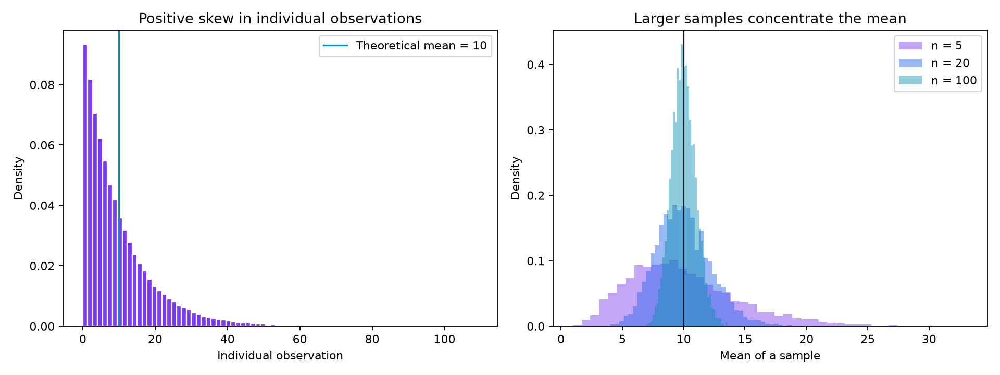
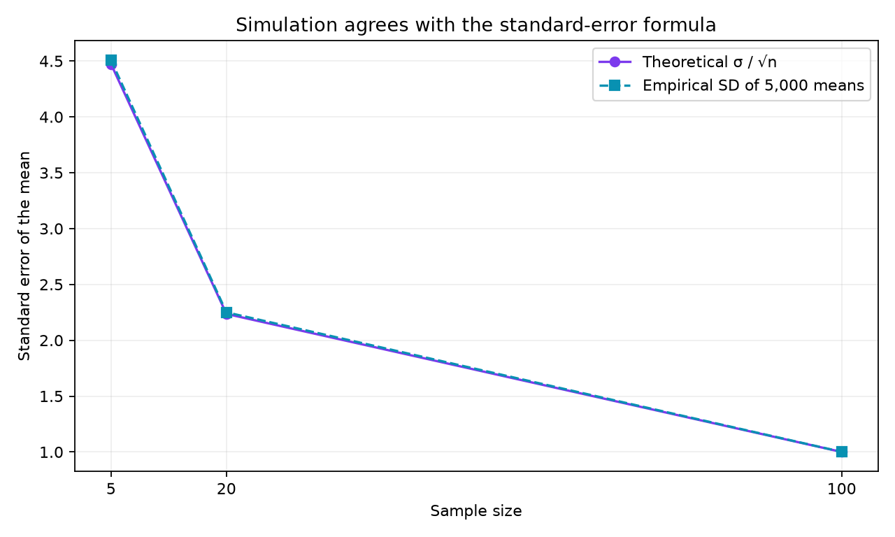

# Oscar Carranza

I am developing reproducible data-analysis and visualization projects as part of my data-science studies. I focus on making assumptions, uncertainty and limitations visible alongside results.

**Technical skills demonstrated here:** Python, NumPy, pandas, Matplotlib, simulation, statistical visualization and reproducible project organization.

## Project: How sample size changes uncertainty in a mean

**Research question:** How does increasing sample size change the variability of a sample mean when individual observations are right-skewed?

### How the simulation works

The Python script uses NumPy with random seed 7204. It generates independent values from an exponential distribution with a mean and standard deviation of 10. For each sample size (5, 20 and 100), it generates 5,000 separate samples and calculates the mean of each sample. Each group therefore contains 5,000 sample means.

The empirical standard error is the standard deviation of those 5,000 means, calculated with `ddof=1`. The theoretical value is `10 / sqrt(n)`. The script also generates 100,000 individual values to show the original distribution in the first chart.

The simulated individual observations are right-skewed, while the averages become more concentrated near 10 as sample size increases. The empirical standard error decreases from 4.507 at n=5 to 1.001 at n=100.

**Limitation:** Independent synthetic exponential observations are a teaching model, not evidence that real-world time series satisfy these assumptions. More observations reduce standard error but do not automatically remove bias.

[View the project repository](https://github.com/OscarCarranzaFeynman/data-science-project) · [Read the analysis script](https://github.com/OscarCarranzaFeynman/data-science-project/blob/main/analysis.py)

**Project status:** Published on GitHub Pages. A classmate confirmed the feedback below on 9 November 2026. The simulation explanation has been updated in response.

## Reading the result

Each plotted sample mean averages a new independent sample. The standard error measures how much those means vary; it is different from the spread of individual observations.

| Sample size | Empirical standard error | Formula: 10 / √n |
| --- | ---: | ---: |
| 5 | 4.507 | 4.472 |
| 20 | 2.250 | 2.236 |
| 100 | 1.001 | 1.000 |

Moving from 5 to 100 observations makes each sample 20 times larger and reduces the theoretical standard error by about 4.47 times. This concerns precision under the stated assumptions; it does not prove that the estimate is unbiased.

## Review and next improvement

**Self-review, 23 October 2026:** A reader could confuse the spread of observations with uncertainty in a mean. I added the explanation and numerical comparison above to make that distinction easier to check. This is a self-review, not classmate feedback.

**Classmate-confirmed feedback, 9 November 2026:** "The research question and charts are clear. I suggest adding a short explanation of how the simulation works, including how many samples were generated for each sample size. This would make the results easier to understand and reproduce."

**Improvement:** Added the simulation method, random seed, sample sizes, 5,000 repetitions per size, and the calculation of empirical standard error. The explanation matches the published Python script. The reviewer's name and student ID are omitted.

[View the feedback and improvement record](PEER_REVIEW.md)

## AI declaration

ChatGPT helped prepare and check this project and its explanation.
