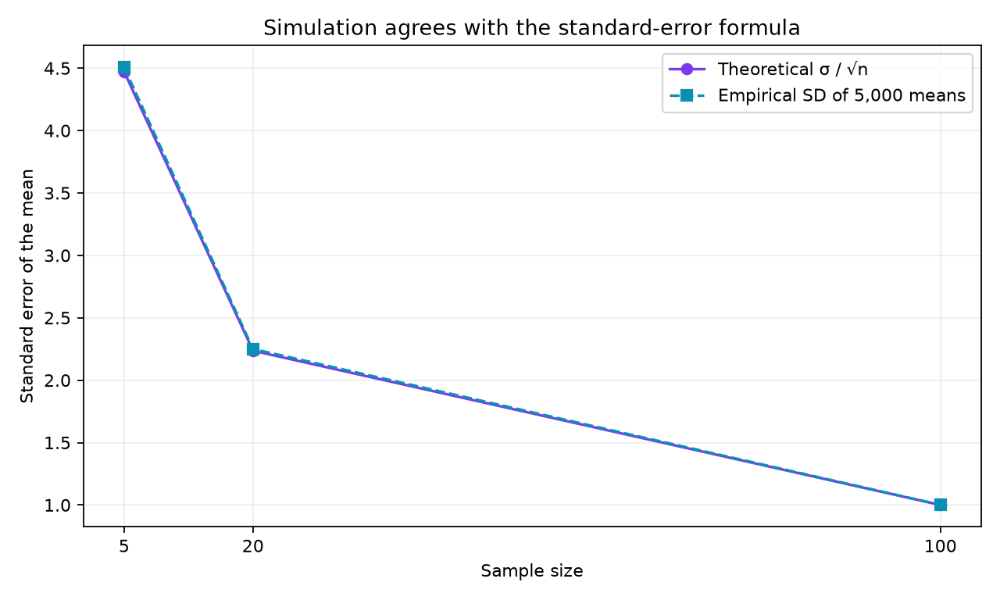

# Oscar Carranza

I am developing reproducible data-analysis and visualization projects as part of my data-science studies. I focus on making assumptions, uncertainty and limitations visible alongside results.

**Technical skills demonstrated here:** Python, NumPy, pandas, Matplotlib, simulation, statistical visualization and reproducible project organization.

## Project: How sample size changes uncertainty in a mean

**Research question:** How does increasing sample size change the variability of a sample mean when individual observations are right-skewed?

The simulated individual observations are right-skewed, while the averages become more concentrated near 10 as sample size increases. The empirical standard error decreases from 4.507 at n=5 to 1.001 at n=100.

**Limitation:** Independent synthetic exponential observations are a teaching model, not evidence that real-world time series satisfy these assumptions. More observations reduce standard error but do not automatically remove bias.

[View the project repository](https://github.com/OscarCarranzaFeynman/data-science-project) · [Read the analysis script](https://github.com/OscarCarranzaFeynman/data-science-project/blob/main/analysis.py)

**Project status:** Publicly published on GitHub Pages. Both figures and the project/code links were checked on 23 October 2026. Genuine classmate feedback and a revision responding to that feedback remain pending.

## Reading the result

Each plotted sample mean averages a new independent sample. The standard error measures how much those means vary; it is different from the spread of individual observations.

| Sample size | Empirical standard error | Formula: 10 / √n |
| --- | ---: | ---: |
| 5 | 4.507 | 4.472 |
| 20 | 2.250 | 2.236 |
| 100 | 1.001 | 1.000 |

Moving from 5 to 100 observations makes each sample 20 times larger and reduces the theoretical standard error by about 4.47 times. This concerns precision under the stated assumptions; it does not prove that the estimate is unbiased.

## Review and next improvement

**Self-review, 23 October 2026:** A reader could confuse the spread of observations with uncertainty in a mean. I added the explanation and numerical comparison above to make that distinction easier to check. This is a self-review, not classmate feedback.

The remaining peer-review step is to ask a classmate to identify the research question, main finding and limitation, then make and commit one documented improvement based on their actual feedback.

## AI declaration

ChatGPT helped prepare and check this project and its explanation.
